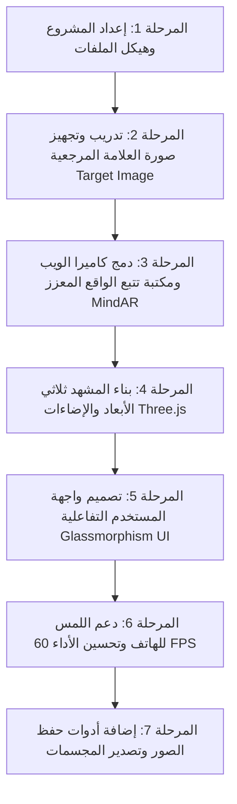

# 📄 بطاقة توصيف المشروع (Fiche de Projet)

---

## 1. المعلومات العامة (Informations Générales)

* **اسم المشروع (Titre du projet) :** منصة الواقع المعزز والتثبيت المكاني ثلاثي الأبعاد عبر الويب (WebAR Spatial 3D Anchor & Canvas)
* **نوع المشروع (Type de projet) :** تطبيق ويب تفاعلي للواقع المعزز ورؤية الكمبيوتر (WebAR / Computer Vision / 3D Interactive Web App)
* **مجال التطبيق (Domaine) :** الواقع المعزز (Augmented Reality)، الجرافيكس ثلاثي الأبعاد (3D Graphics)، الحوسبة المكانية (Spatial Computing)
* **المنصات المدعومة (Plateformes) :** متعدد المنصات (Cross-Platform) — يعمل على الحواسيب (PC/Laptop) والهواتف الذكية (Android و iOS) مباشرة عبر المتصفح دون الحاجة لتثبيت أي تطبيق خارجي.

---

## 2. ملخص وسياق المشروع (Contexte & Résumé)

يهدف هذا المشروع إلى سد الفجوة بين العالم الحقيقي والعالم الرقمي ثلاثي الأبعاد باستخدام **كاميرا الويب العادية** أو **كاميرا الهاتف الذكي**. 
يقوم النظام بالتعرف على ورقة أو صورة مرجعية (Marker / Physical Anchor) في العالم الواقعي وتثبيت مجسمات ثلاثية الأبعاد ($3D$ Objects) فوقها بدقة مليمترية. يستطيع المستخدم التحرك حول المجسم بزاوية 360 درجة، تدويره، تغيير أبعاده وألوانه، ورؤيته يطفو في مكانه الواقعي وكأنه مجسم حقيقي موضوع على الطاولة.

---

## 3. الأهداف الرئيسية (Objectifs du Projet)

1. **التثبيت المكاني في الوقت الفعلي (Real-Time Spatial Anchoring):** ربط المحتوى الرقمي ثلاثي الأبعاد بجسم واقعي (ورقة / علامة) والتكيف مع حركات الكاميرا في الوقت الحقيقي بسرعة 60 إطاراً في الثانية.
2. **التشغيل المباشر عبر الويب (Zero-Install WebAR):** توفير تجربة سريعة تعمل عبر متصفحات الويب الحديثة (Chrome, Safari, Edge) دون الحاجة لمتجر تطبيقات أو ملفات تثبيت ثقيلة.
3. **التفاعل ثنائي النمط (Dual Interaction):**
   * **على الحاسوب:** التحكم بالماوس وزوايا الرؤية ومفاتيح الاختصار.
   * **على الهاتف:** التفاعل عبر اللمس المتعدد (Multi-touch Gestures: Pinch-to-zoom, Drag-to-rotate) واستخدام مستشعرات الكاميرا الخلفية.
4. **جماليات بصرية متطورة:** استخدام إضاءات نيون مشعة (Bloom / Glow Effects) وخامات ثلاثية أبعاد واقعية (PBR Materials).
5. **تصدير ومشاركة الأعمال:** إمكانية التقاط صور للواقع المعزز (AR Snapshot) وتصدير المجسمات.

---

## 4. الميزات والوظائف الأساسية (Fonctionnalités Clés)

| الميزة | الوصف التقني |
| :--- | :--- |
| **تتبع الصور والأوراق (Image Tracking)** | كشف العلامة الورقية وتحديد موقعها ثلاثي الأبعاد ($X, Y, Z$) وزوايا دورانها (Roll, Pitch, Yaw). |
| **المجسمات التفاعلية (Interactive 3D)** | عرض مجسمات ثلاثية الأبعاد متنوعة (أشكال هندسية متطورة، نماذج كرتونية، أو تصاميم منتجات). |
| **التحكم والتدوير (Transform Controls)** | إمكانية تدوير المجسم 360°، تكبيره وتصغيره (Scaling)، وتعديل ارتفاعه فوق الورقة. |
| **لوحة تحكم عصرية (Glassmorphism UI)** | واجهة تحكم عائمة بتصميم زجاجي داكن تسمح بتغيير الألوان، الإضاءة، ونوع المجسم. |
| **التقاط الصور (Snapshot / Screenshot)** | زر فوري لالتقاط صورة عالية الدقة تجمع بين المشهد الحقيقي والمجسم الافتراضي لحفظها على الجهاز. |
| **مؤشر حالة التتبع (Tracking Indicator)** | تنبيه مرئي يوضح للمستخدم ما إذا كانت الورقة في مجال الرؤية أم مفقودة (Target Found / Lost). |

---

## 5. الحزمة التقنية والأدوات (Pile Technologique / Tech Stack)

### أ. لغات البرمجة والواجهة:
* **HTML5 & CSS3:** هيكلة التطبيق وتصميم واجهة المستخدم العصرية المتجاوبة (Responsive Mobile & Desktop Design).
* **JavaScript (ES6+) / TypeScript:** كتابة المنطق البرمجي، التحكم بالأحداث، وإدارة تدفق الفيديو والـ 3D.

### ب. المكتبات ومحركات العرض:
* **MindAR.js (أو AR.js):** مكتبة الذكاء الاصطناعي لرؤية الكمبيوتر المعتمدة على WebGL لتتبع الصور في الوقت الفعلي بأعلى أداء.
* **Three.js:** محرك الرسوميات ثلاثي الأبعاد الرائد عالمياً لإدارة المشهد (Scene, Camera, Lights, Meshes, Materials).
* **Three.js Post-Processing (UnrealBloomPass):** لإضافة تأثيرات الإضاءة والتوهج المستقبلي.

### ج. بيئة التطوير والتشغيل:
* **Vite / Node.js:** بيئة بناء وخادم محلي فائق السرعة يدعم الـ Hot Module Replacement وشبكة الـ Wi-Fi المحلية للتجربة المباشرة على الهاتف.
* **WebRTC & MediaDevices API:** للوصول المباشر إلى كاميرا الويب وكاميرا الهاتف بدقة عالية وأمان.

---

## 6. المتطلبات التقنية (Prérequis)

* **الأجهزة (Hardware):**
  * كمبيوتر مع كاميرا ويب (Webcam) مدمجة أو خارجية.
  * أو هاتف ذكي (Android أو iPhone) مزود بكاميرا عادية.
  * ورقة مطبوعة أو صورة معروضة على شاشة هاتف ثانٍ لتكون العلامة المرجعية (Marker Target).
* **البرمجيات (Software):**
  * متصفح حديث يدعم WebGL (Google Chrome, Microsoft Edge, Safari, Firefox).
  * Node.js مثبت على جهاز المطور لإدارة الحزم والتشغيل.

---

## 7. مراحل تنفيذ المشروع (Étapes de Réalisation / Roadmap)

1. **المرحلة 1:** إنشاء مشروع الويب وتثبيت حزم `three` و `mind-ar` ومحرك البناء.
2. **المرحلة 2:** توليد ملف تتبع الصورة (`.mind`) للورقة التي سيتم توجيه الكاميرا إليها.
3. **المرحلة 3:** ربط تدفق كاميرا الويب مع محرك Three.js وضبط نظام الإحداثيات العالمي.
4. **المرحلة 4:** إضافة المجسمات ثلاثية الأبعاد والمواد المضيئة والتحكم بالدوران والتكبير.
5. **المرحلة 5:** بناء واجهة تحكم متجاوبة (تعمل بالماوس على الكمبيوتر وباللمس على الهاتف).
6. **المرحلة 6:** الاختبار والتشغيل على الشبكة المحلية وتجربتها فوراً بالهاتف والكمبيوتر.

---

## 8. آفاق التطوير المستقبلية (Perspectives d'Évolution)

* 🎨 **الرسم ثلاثي الأبعاد في الهواء (Spatial 3D Drawing):** السماح للمستخدم بالرسم فوق الورقة وتشكيل مجسمات حرة في الفضاء.
* 🤖 **تتبع اليد بدون ورقة (Markerless Hand Tracking):** دمج MediaPipe ليتسنى للمستخدم إمساك المجسم بأصابعه دون الحاجة لورقة.
* 🏢 **تطبيقات تجارية:** استخدام النظام لعرض المنتجات في المتاجر الإلكترونية (3D E-Commerce Product Preview)، أو في المناهج التعليمية لعرض المجسمات العلمية والطبية.
